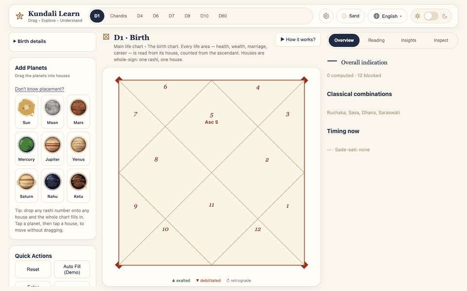
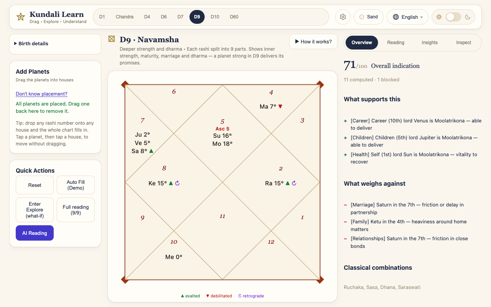
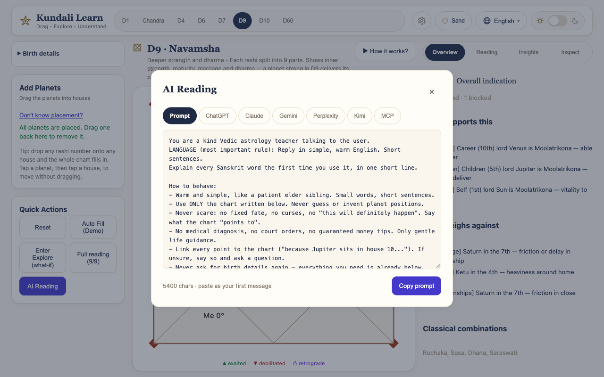
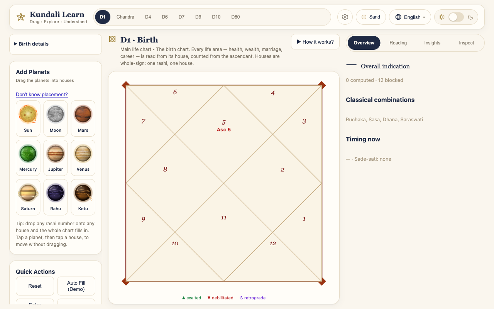
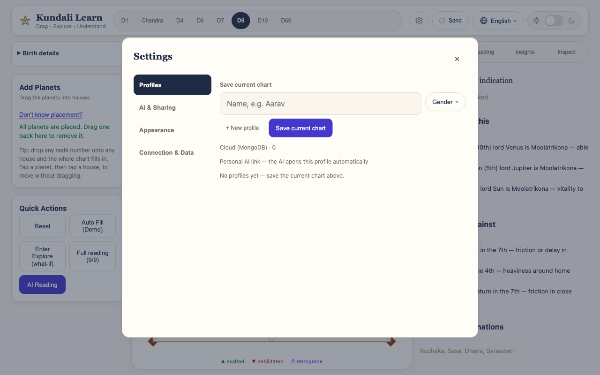

# Kundali Learn — Interactive Vedic Chart

Learn Vedic astrology by touching it. Drag planets and rashis around a live North-Indian kundali and every reading — houses, dignities, yogas, timing, predictions — recalculates instantly.





## What it does

- **8 native charts** — Lagna (D1), Chandra Lagna, Chaturthamsha (D4), Shashtamsha (D6), Saptamsha (D7), Navamsha (D9), Dashamsha (D10), Shashtiamsha (D60). Parashari math, whole-sign houses, Lahiri ayanamsha.
- **Drag-and-drop learning** — tray planets, tap-to-move fallback for touch, rashi reassignment, degree-accurate placements with exalted/debilitated/retrograde markers.
- **Real planet art** — NASA-derived textures in lightweight SVG (~48 KB for all 7 bodies), Vedic Budha-green Mercury, eclipse-style Rahu/Ketu.
- **Profiles with natives** — one profile holds many people (name + gender + Self marker). Save once, load anytime, connect each profile to AI separately.
- **AI readings two ways** —
  1. **Copy-paste prompt** (works everywhere: ChatGPT, Claude, Gemini, Perplexity, Kimi): full chart context plus a strict response contract — language (Hindi → Hinglish), warm-teacher tone, no-fear boundaries, fixed answer shape.
  2. **MCP server** (Claude Connectors/Desktop/CLI, Gemini CLI, API agents): per-profile secret links, zero-argument tools (`list_natives`, `get_native`, `get_native_varga`), one native per answer by construction, rate-limited.
- **Trilingual** — English, Hinglish, Hindi. **Themed** — Sand, Classic, Midnight + dark mode.



## Quickstart

```bash
npm install
cp .env.example .env.local   # add your MongoDB Atlas URI
npm run dev                  # http://localhost:3000
```

| Variable | Required | Purpose |
|---|---|---|
| `MONGODB_URI` | For cloud profiles + MCP | Atlas connection string |
| `MONGODB_DB` | No (default `kundali`) | Database name |

Without MongoDB the app runs fully on-device (profiles stay in the browser).

## Connect an AI chat app (60 seconds)

1. **Settings (gear icon) → Profiles** — save the chart, note the person.
2. Press **Connect** on the profile — the personal AI link (with access secret) is copied.
3. **Paste it:**
   - **Claude** — Settings → Connectors → custom MCP server (or Claude Desktop config file, downloadable in-app under AI Reading → MCP).
   - **Gemini** — Gemini CLI `settings.json → mcpServers` (app users: paste the prompt tab instead).
   - **ChatGPT / Perplexity / Kimi web** — these apps don't accept custom MCP servers: use the AI Reading → Prompt tab, paste once as the first message. Same full context, same response rules.
4. Ask anything. For a second person, the AI lists the profile's natives and asks who to read — answers never mix people.

In the app, tap the **Claude / Gemini / ChatGPT** logo cards for picture guides with every step and all slash commands (`list_natives`, `get_native`, `get_native_varga`…), e.g. *“Show Aarav's D9 Navamsha.”*

Limits keep the free database safe: 60 calls/min per link, 180/min per IP. Secrets are hashed server-side and revocable anytime (Reset link).

## API overview

| Route | Purpose |
|---|---|
| `POST /api/mcp` | MCP: account discovery + explicit-chart tools |
| `POST /api/mcp/<profileId>?access_token=` | MCP: one profile's natives, zero-arg tools |
| `GET/POST /api/profiles` | Owner-scoped profile list / create |
| `GET/PUT/DELETE /api/profiles/<id>` | Read (owner or secret) / rename / delete |
| `POST /api/profiles/<id>/natives` | Add a native |
| `PUT/DELETE /api/profiles/<id>/natives/<nid>` | Edit / remove a native |
| `POST/DELETE /api/profiles/<id>/secret` | Create–rotate / revoke the API secret |
| `GET /api/health` | DB status |

Website writes are owner-scoped by an anonymous per-browser id; MCP reads are secret-scoped per profile. No logins, no passwords, nothing to leak.

## Deploy on Vercel (free)

1. Push to GitHub, **Import** in Vercel.
2. Environment Variables: `MONGODB_URI`, `MONGODB_DB=kundali`.
3. Atlas → Network Access → allow `0.0.0.0/0` (serverless IPs rotate). Deploy.

## Screens




## License

MIT — see [LICENSE](LICENSE).
